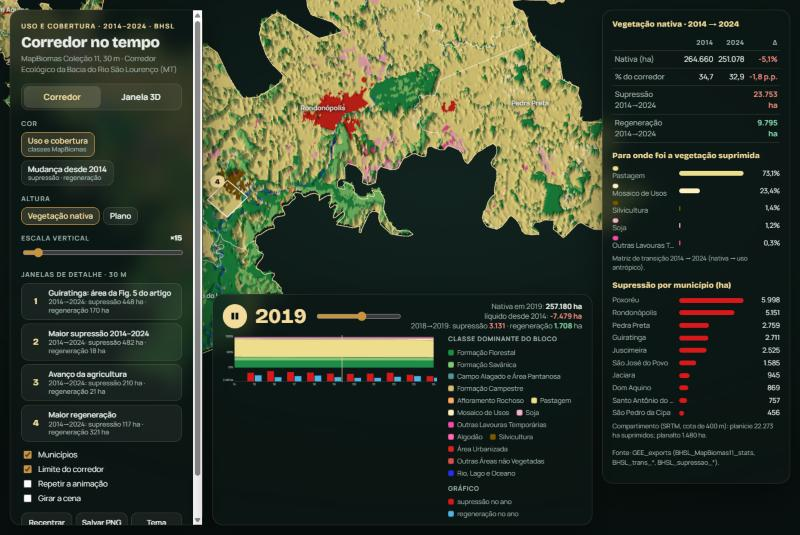
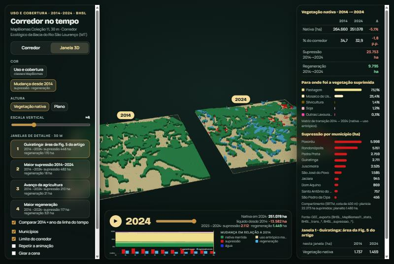

# Corredor no tempo · Uso e cobertura da terra em 3D no Corredor do Rio São Lourenço (MT), 2014–2024

Visualização 3D interativa (Three.js) do **uso e cobertura da terra** no Corredor Ecológico da Bacia do Rio São Lourenço (BHSL), Mato Grosso, Brasil. Os dados são do MapBiomas Coleção 11, ano a ano de 2014 a 2024. A página tem uma **linha do tempo** que anima as mudanças: o relevo da vegetação nativa afunda onde há supressão.

**Página:** `https://<usuario>.github.io/lulc-3d-bhsl/`





> *English summary.* Interactive 3D viewer (Three.js) of land use and land cover (MapBiomas Collection 11, 30 m) in the São Lourenço River Basin ecological corridor (Mato Grosso, Brazil), 2014–2024. It shows:
> - a **timeline** (play, scrub, click on the chart) that animates the corridor year by year;
> - relief = share of native vegetation per 300 m block;
> - colour = dominant MapBiomas class or change since 2014 (suppression / regeneration);
> - 30 m detail windows with per-pixel trajectories.
>
> Interface in Portuguese.

## O que a página mostra

| Elemento | Conteúdo |
|---|---|
| **Linha do tempo** | botão ▶ (anima 2014 → 2024, cerca de 1,3 s por ano), régua e clique no gráfico para escolher o ano; espaço e setas do teclado também funcionam. O gráfico empilha a composição do corredor (% da área) e, embaixo, mostra a supressão (vermelho) e a regeneração (azul) de cada ano em relação ao anterior. |
| **Corredor** | blocos de 10 × 10 pixels (300 m). A altura é a fração do bloco coberta por vegetação nativa no ano; a animação interpola os anos. A cor é a classe dominante do bloco (paleta oficial do MapBiomas) ou a mudança desde 2014. Os municípios e o limite do corredor aparecem por cima. |
| **Janela 3D** | quatro recortes de 192 × 192 pixels (5,76 km) em 30 m, mostrados como blocos: <br>1. a área de Guiratinga da Fig. 5 do artigo; <br>2. a maior supressão 2014–2024; <br>3. o avanço da agricultura; <br>4. a maior regeneração. <br>A vegetação nativa aparece elevada: é um marcador, não a altura da vegetação. Ao passar o cursor, a página mostra a **trajetória do pixel** ano a ano. |
| **Comparar** | 2014 ao lado do ano escolhido na linha do tempo. |
| **Painel** | vegetação nativa 2014 × 2024, supressão e regeneração brutas, destino da vegetação suprimida, supressão por município e por compartimento (planície × planalto). |

Grupos usados, os mesmos do script de transições:
- **nativa:** classes 3, 4, 5, 6, 11, 12, 29, 49, 50;
- **água:** 26, 33;
- **uso antrópico:** o restante.

Supressão = nativa em 2014 e uso antrópico no ano; regeneração = o inverso.

## Principais números (lidos de `data/`)

| | 2014 | 2024 | Δ |
|---|---|---|---|
| Vegetação nativa (ha) | 264.660 | 251.078 | −5,1% |

- Supressão bruta 2014 → 2024: 23.753 ha. Regeneração: 9.795 ha.
- 73,1% da vegetação suprimida virou pastagem e 23,4% virou mosaico de usos.
- Poxoréu (5.998 ha) e Rondonópolis (5.151 ha) concentram a maior supressão.

## Dados (`data/`)

| Arquivo | Conteúdo |
|---|---|
| `BHSL_MB11_2014_2024_stack.tif` | classes MapBiomas Coleção 11, 11 bandas (2014–2024), 30 m, SIRGAS 2000 / UTM 21S (EPSG:31981) |
| `BHSL_MapBiomas11_stats.csv` | área por classe e ano |
| `BHSL_trans_anuais.csv`, `BHSL_trans_2014_2024.csv` | transições t−1 → t e matriz 2014 → 2024 |
| `BHSL_supressao_municipios.csv`, `BHSL_supressao_compartimento.csv` | supressão e regeneração por município e por compartimento (SRTM, cota de 400 m) |
| `BHSL_municipios.geojson` | municípios do corredor |
| `CESL_V01_limite_corredor.*` | limite do corredor |

Os dados foram gerados no Google Earth Engine pelos scripts em [`gee/`](gee/). Eles leem o limite do corredor de um asset do autor (`projects/ee-davidaranha/...`); para rodar em outra conta, troque esse caminho pelo seu.

## Reconstruir a página

```bash
pip install -r requirements.txt
python scripts/exportar_visualizacao_3d_lulc.py     # lê data/ e web/, grava docs/index.html
```

O resultado é um HTML único, de ~2 MB: os 11 anos vão em `uint8` comprimido (zlib + base64) e o navegador descompacta com `DecompressionStream`. Para editar o visual, mexa em `web/visualizador_lulc_3d.template.html` e rode o script de novo; não edite `docs/index.html` à mão.

## Publicar no GitHub Pages

*Settings → Pages → Build and deployment → Deploy from a branch → `main` / `docs`*

## Projetos irmãos (mesmo corredor, mesmo motor 3D)

- [icea-canopy-3d-bhsl](https://github.com/bonnexd01/icea-canopy-3d-bhsl): estrutura do dossel (ICEA) com mapas globais de altura e lidar GEDI.
- [fragconn-3d-bhsl](https://github.com/bonnexd01/fragconn-3d-bhsl): fragmentação e conectividade da vegetação natural.

O visual dos três foi inspirado em [linaq11/lidar-mangrove-canopy](https://github.com/linaq11/lidar-mangrove-canopy).

## Citação e licença

Autor: David Albuquerque Aranha ([ORCID 0009-0005-1631-1676](https://orcid.org/0009-0005-1631-1676)). Ver [`CITATION.cff`](CITATION.cff).

- Código: licença MIT ([`LICENSE`](LICENSE)).
- Dados: CC BY 4.0, com atribuição ao Projeto MapBiomas (https://brasil.mapbiomas.org).

### Referência

- Souza CM Jr et al. 2020. Reconstructing three decades of land use and land cover changes in Brazilian biomes with Landsat archive and Earth Engine. *Remote Sensing* 12: 2735. https://doi.org/10.3390/rs12172735
